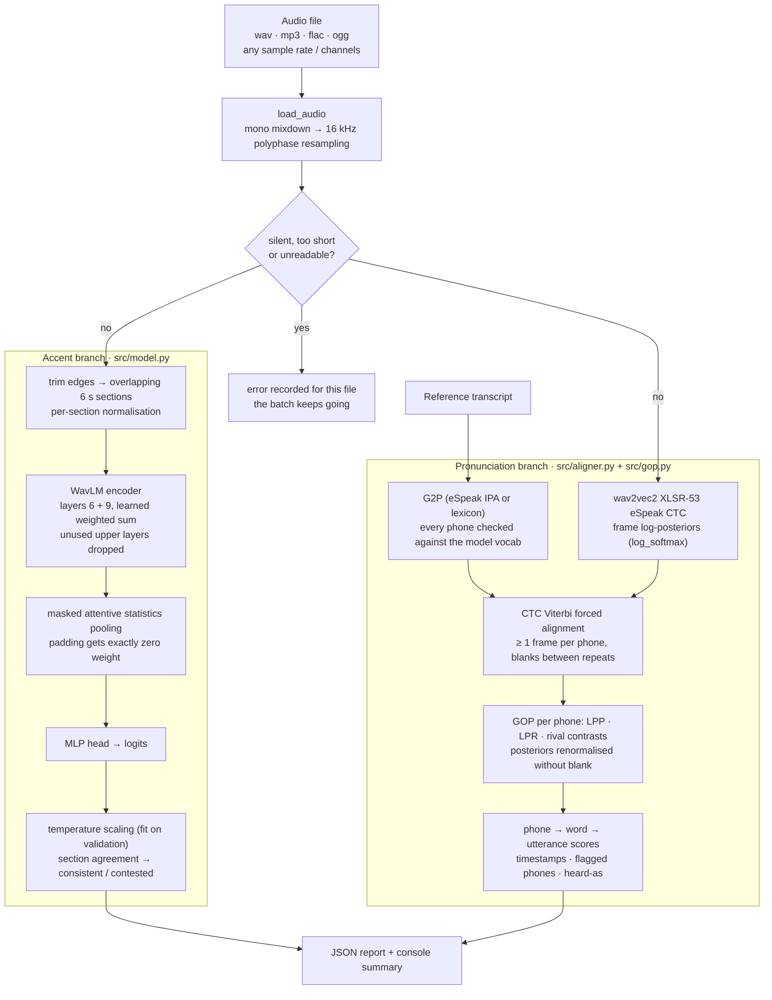

# Hearing Where Someone Comes From

**Indian-English accent detection and phone-level pronunciation scoring (GOP)**

[](https://github.com/saumyadeepgain/accent-detection-gop/actions/workflows/ci.yml)


Give it a recording (and, optionally, what the speaker was reading) and it returns:

1. **Accent:** the speaker's likely first language (Tamil, Telugu, Hindi, Kannada, Malayalam, Marathi, Bengali). It comes with temperature-calibrated probabilities, and for long recordings a check on whether the sections of the recording agree (`consistent` / `contested`).
2. **Pronunciation:** an overall score (0–100) plus a score for every word and every phone, with timestamps. Phones below a threshold are flagged, along with what they sounded like (`/w/ heard as /v/`).

The accent model is a WavLM encoder with masked attentive statistics pooling. Pronunciation is scored with **Goodness of Pronunciation (GOP)**: posteriors from a wav2vec2 phoneme recogniser are aligned to the transcript by CTC forced alignment. The test suite runs on CPU with synthetic audio and needs no downloads.

> [!IMPORTANT]
> This repository started as a narrative notebook whose figures were all simulated. `docs/AUDIT.md` documents that, and every other silent bug class the refactor fixes. The notebook is kept in `notebooks/` as an illustration and carries a disclaimer. The results tables below contain **only measured numbers**, and accuracy cells stay empty until a real training run fills them.

---

## Contents

- [Pipeline](#pipeline)
- [Quick start](#quick-start)
- [Dataset setup (speaker-disjoint)](#dataset-setup-speaker-disjoint)
- [Training](#training)
- [Evaluation](#evaluation)
- [Inference CLI](#inference-cli)
- [Results](#results)
- [Design decisions](#design-decisions)
- [Testing and CI](#testing-and-ci)
- [Project structure](#project-structure)
- [Background: what makes an accent](#background-what-makes-an-accent)
- [Limitations and next steps](#limitations-and-next-steps)
- [References](#references)

## Pipeline



The GOP terms, per phone, over the frames where the alignment emits it:

| Term | Definition | Meaning |
|---|---|---|
| **LPP** | mean log P(target \| frame) | how probable the expected phone is |
| **LPR** | mean [log P(target) − max other log P] | margin over the best competing phone |
| **rival(r)** | mean [log P(target) − log P(r)] | margin over a specific L1-typical substitute (`gop.rivals`, e.g. `v → w, ʋ`, `θ → t, t̪`) |
| **score** | sigmoid((LPR − center) / scale) | 0–1; flagged below `gop.flag_threshold` |

## Quick start

```bash
git clone https://github.com/saumyadeepgain/accent-detection-gop.git
```

```bash
cd accent-detection-gop
```

```bash
python -m venv .venv && source .venv/bin/activate
```

```bash
make install-cpu        # pinned deps, CPU PyTorch  (use `make install` for CUDA wheels)
```

```bash
sudo apt-get install -y espeak-ng      # eSpeak G2P; macOS: brew install espeak-ng
```

```bash
make demo               # offline smoke run on synthetic data: train -> eval -> predict (< 1 min, CPU)
```

```bash
make install-dev && make test          # 105 tests, about 30 s on CPU
```

`make help` lists every target: `train`, `resume`, `eval`, `eval-gop`, `predict`, `lint`, `format`, `cov`, `clean`, and more.

## Dataset setup (speaker-disjoint)

Download the corpora yourself, because each has its own licence: [NISP](https://arxiv.org/abs/2007.06021), [AccentDB](https://github.com/AccentDB/data) and [Svarah](https://arxiv.org/abs/2305.15760). Then write one CSV manifest, `data/manifest.csv` by default:

```csv
path,speaker_id,accent,source,text
nisp/Tamil/spk013/utt04.wav,spk013,Tamil,NISP,
svarah/audio/0453.wav,0453,Hindi,Svarah,please call stella
```

| Column | Required | Notes |
|---|---|---|
| `path` | yes | relative to the manifest folder (or `data.audio_root`); wav / flac / mp3 / ogg, any rate |
| `speaker_id` | yes | **splits are made over speakers**, never over utterances |
| `accent` | yes | one of `data.accents` |
| `source` | recommended | the corpus. Speaker IDs are namespaced by it (`NISP/spk01` ≠ `Svarah/spk01`), and it enables a cross-corpus test |
| `utt_id`, `text`, `gender` | optional | `text` is used by the GOP tools |

What happens on the first `make train`:

1. **Audio check:** every file is decoded once. Missing, corrupted, silent (`audio.silence_rms_db`) and too-short (`audio.min_duration`) clips are dropped, and the log lists how many and why.
2. **Speaker-disjoint split:** for each accent, whole speakers are assigned to train / val / test (`data.val_frac`, `data.test_frac`). `assert_speaker_disjoint` raises a `LeakageError` if any speaker lands in two splits.
3. **Cross-corpus test (optional):** `--set data.test_sources=[Svarah]` holds out a whole corpus. This is the honest check that the model learned accents rather than microphones.
4. **Saved split:** the split goes to `<out_dir>/split.csv` and is reused on resume and in `make eval`. It is re-checked for leakage every time it is loaded.

> Never cut recordings into sections before splitting: sections of one recording would end up in both train and test. Sectioning here happens only at evaluation and inference time.

**GOP evaluation data** uses a second CSV, `path,text[,human_score][,phone_labels]`. `human_score` is any utterance-level rating (e.g. speechocean762). `phone_labels` is a space-separated 0/1 per canonical phone, where 1 means mispronounced (e.g. derived from L2-ARCTIC annotations).

## Training

```bash
make train                                             # config.yaml -> runs/default
```

```bash
make train OUT=runs/wavlm_l69 ARGS="--lr 3e-4 --backbone_lr 2e-5 --batch_size 8"
```

```bash
python -m src.train --set model.layers=[4,8] --set data.test_sources=[Svarah] --loss focal
```

```bash
make resume OUT=runs/wavlm_l69                         # continue exactly where it stopped
```

Every key in `config.yaml` is a flag: `--train.lr`, the short form `--lr` where it is unambiguous, or `--set key=value` (YAML values, so lists and maps work).

Training covers:
- **Data:** length-bucketed batches.
- **Loss:** class-weighted CE or focal loss.
- **Precision:** AMP (bf16, or fp16 with GradScaler).
- **Optimisation:** gradient accumulation and clipping; warmup + cosine LR per step; differential learning rates (pretrained transformer `backbone_lr`, head `lr`).
- **Stopping:** early stopping on macro-F1 / UAR.
- **Resume:** complete — model, optimizer, scheduler, scaler, RNG and early-stopping state. A test checks that a resumed run matches an uninterrupted one.

Each run writes to `runs/<name>/`:

| File | Content |
|---|---|
| `best.pt` | inference checkpoint: weights, config, accents, fitted temperature, HF config (loads offline) |
| `last.pt` | full training state for `--resume` |
| `split.csv` | the speaker-disjoint split |
| `history.json`, `logs/train_*.log` | per-epoch metrics, full log |
| `metrics.json`, `test_confusion_matrix.png`, `*_reliability.png` | final validation / test evaluation |

## Evaluation

```bash
make eval SPLIT=test            # or: python -m src.evaluate accent --checkpoint runs/default/best.pt --split test
```

```bash
make eval-gop GOP_MANIFEST=data/speechocean_test.csv
```

| Task | Metrics |
|---|---|
| Accent | accuracy, **macro-F1**, **UAR** (balanced accuracy), per-accent precision / recall / F1, confusion-matrix PNG, NLL, ECE before / after temperature scaling, reliability PNG, fraction of `contested` recordings |
| GOP | **Pearson / Spearman** with human scores, **AUC-ROC** and **EER** for mispronunciation detection, per-phone score statistics and distribution PNG, per-utterance JSONL |

## Inference CLI

```bash
python -m src.predict --audio clip.wav --text "Please call Stella" \
    --accent-checkpoint runs/default/best.pt --output report.json
```

```bash
python -m src.predict --audio recordings/ -r --text-file transcripts.tsv --output reports.json
```

```bash
make predict AUDIO=clip.mp3 TEXT="Please call Stella" CKPT=runs/default/best.pt
```

- `--audio` takes files and/or folders (`-r` recurses).
- `--text-file` is a TSV of `file<TAB>transcript`.
- `--output -` prints the JSON to stdout and sends the readable report to stderr.
- Either part can be left out: without a checkpoint only pronunciation is scored, without a transcript only the accent.
- The phoneme model defaults to `facebook/wav2vec2-xlsr-53-espeak-cv-ft`; override it with `--phoneme_model`.
- Exit code: 0 = all files scored, 2 = some files failed (each failure is reported in the JSON), 1 = fatal error.

Console report:

```text
hello_world (synthetic posteriors)  1.0 s  (16 kHz, 1 ch)
  Accent         Tamil 76%  (Telugu 22%, Hindi 2%)  1 section(s), agreement 100% [consistent]
  Pronunciation  83.0 / 100  (1 of 8 phones below 0.50)
    hello          0.90   h 0.90  ə 0.90  l 0.90  oʊ 0.90
    world          0.76   w 0.31!  ɜː 0.90  l 0.90  d 0.90
    flagged /w/ in 'world'  0.64-0.68 s  score 0.31  heard as /v/
```

JSON report (trimmed: `hello` and three phones omitted):

```json
{
  "models": {"accent_checkpoint": "runs/demo/run/best.pt", "phoneme_model": "(synthetic posteriors)",
             "g2p": "lexicon", "flag_threshold": 0.5},
  "results": [{
    "file": "hello_world (synthetic posteriors)", "duration": 1.02, "sample_rate": 16000,
    "channels": 1, "error": null, "warnings": [],
    "accent": {"label": "Tamil", "confidence": 0.7574,
               "probabilities": {"Tamil": 0.7574, "Telugu": 0.2181, "Hindi": 0.0157, "Bengali": 0.0037,
                                 "Kannada": 0.0025, "Marathi": 0.0015, "Malayalam": 0.0012},
               "segments": 1, "agreement": 1.0, "verdict": "consistent", "temperature": 1.0},
    "pronunciation": {
      "transcript": "Hello world", "error": null, "unknown_phones": [],
      "overall_score": 83.0, "num_phones": 8, "num_flagged": 1,
      "words": [{
        "word": "world", "start": 0.64, "end": 0.82, "score": 0.7557, "flagged": true,
        "phones": [
          {"phone": "w", "start": 0.64, "end": 0.68, "frames": 2, "lpp": -1.8667, "lpr": -1.6094,
           "score": 0.309, "flagged": true, "heard_as": "v",
           "rivals": {"v": -1.6094, "ʋ": 2.7081}, "zero_length": false}
        ],
        "unscored_phones": []
      }],
      "flagged": [{"word": "world", "phone": "w", "start": 0.64, "end": 0.68,
                   "score": 0.309, "heard_as": "v"}],
      "alignment": {"frames": 51, "frame_shift": 0.02, "phones_per_second": 7.84}
    }
  }]
}
```

> This sample is produced by `docs/make_sample_report.py` using the real alignment and scoring code. The inputs are synthetic, so it runs offline: frame posteriors in which /w/ was said as /v/, and the `make demo` accent model, which is trained on synthetic tones. It shows the format, not real accuracy.

## Results

### Accent detection (to be filled from `runs/<name>/metrics.json`)

| Model | Test set | Accuracy | Macro-F1 | UAR | ECE |
|---|---|---|---|---|---|
| WavLM Base+ L6+L9, attentive-stats pooling, fine-tuned | speaker-disjoint (NISP + AccentDB + Svarah) | – | – | – | – |
| same | Svarah held out (`data.test_sources=[Svarah]`) | – | – | – | – |
| `mel_cnn` baseline (from scratch) | speaker-disjoint | – | – | – | – |

### Ablations (template)

| Change vs. default | Macro-F1 | UAR | Δ macro-F1 |
|---|---|---|---|
| `model.pooling=mean` (masked mean) | – | – | – |
| `model.layers=[12]` (last layer only) | – | – | – |
| `model.freeze_backbone=true` | – | – | – |
| `train.loss=focal` | – | – | – |
| `augment.enabled=false` | – | – | – |

### Pronunciation scoring (GOP)

| Data | Pearson | Spearman | AUC-ROC | EER |
|---|---|---|---|---|
| utterance-level human scores (e.g. speechocean762) | – | – | n/a | n/a |
| phone-level mispronunciation labels (e.g. L2-ARCTIC) | n/a | n/a | – | – |

### Measured engineering checks

These come from `python docs/benchmark.py` (`docs/benchmark.json`) and the tests. They were measured on 4 threads of an Intel Xeon at 2.1 GHz (cloud VM), PyTorch 2.15, CPU only. The encoders have their real sizes but random weights, which is enough for timing.

| Check | Result |
|---|---|
| Padding invariance: 2 s clip alone vs padded next to a 5 s clip (WavLM Base+-sized) | max \|Δ logit\| = 1.5 × 10⁻⁷ (test tolerance 10⁻⁴) |
| Accent model, WavLM Base+ architecture with 9 of 12 layers kept (73.8 M params), one 6 s clip | 0.44 s |
| Accent model, `mel_cnn` (0.1 M params), one 6 s clip | 6.8 ms |
| Phoneme model, XLSR-53 large architecture (315.8 M params), 5 s utterance | 0.68 s |
| CTC forced alignment, 30 s of audio (1,500 frames), 300 phones | 36 ms |
| Alignment of synthetic posteriors with a known answer (8 and 200 phones) | exact |
| Simulated /w/ → /v/ substitution | /w/ score 0.90 → 0.31, flagged, heard as /v/ |

## Design decisions

- **Speaker-disjoint everything.** Utterance-level splits let a model memorise voices and microphones. Splits are per speaker and per accent, speaker IDs are namespaced by corpus, and leakage is asserted every time a split is created or reloaded.
- **Padding cannot change a prediction.**
  - Frame masks come from the encoder's own conv arithmetic (`_get_feat_extract_output_lengths`), and all pooling is masked.
  - Encoders with GroupNorm over time (WavLM Base / Base+, wav2vec2-base) are not padding-safe even with an attention mask, so they encode each distinct length unpadded.
  - The mel-CNN uses `center=False` STFT frames and zeroes invalid frames between convolutions.
- **Only the layers that are used are run.** With `layers: [6, 9]`, encoder layers 10+ are removed, so 3 of Base+'s 12 transformer layers never run, and none of the remaining parameters is left without a gradient. For pre-LN models the final LayerNorm is dropped as well, so layer 9 keeps its original features.
- **GOP from log-probabilities, with blank handled.** Scores use `log_softmax` output, never logits. CTC posteriors are peaky and mostly blank, so each phone is scored on the frames where the Viterbi path emits it, after renormalising over non-blank tokens with a stable `logsumexp`.
- **One phone inventory.** The acoustic model's `vocab.json` is the authority. G2P output is normalised (`g`→`ɡ`, stress marks, tie bars, length marks); ARPAbet lexicons are converted; anything left over is reported in `unknown_phones` and never scored as `<unk>`.
- **Honest probabilities.** The temperature is fitted on validation, never test. It is skipped when validation is too small or the fit hits its bound (a perfectly separable validation set drives T → 0). ECE counts confidence 1.0.
- **Accent-safe augmentation.** Additive noise at a sampled SNR, optional gain and SpecAugment masks, all within each clip's valid frames. There is no pitch shifting or speed warping, because those move formants and rhythm, i.e. the accent cues themselves. Gain is off by default: per-utterance normalisation removes a constant gain, and the config validator explains this if you turn it on.
- **Graceful failure.** Unreadable, silent, too-short or NaN-containing audio is reported per file. Infeasible alignments (audio too short for the transcript) and unknown words come back as `error` in the report, not as a crash.

## Testing and CI

```bash
make test                                   # or: python -m pytest
```

```bash
python -m pytest tests/test_audio_padding.py -v
```

```bash
make cov                                    # coverage report
```

```bash
make lint                                   # ruff check + ruff format --check (as in CI)
```

| File | What it proves |
|---|---|
| `test_audio_padding.py` | 2 s clip alone vs padded next to 5 s gives the same logits and embedding within 1e-4, for mel-CNN, layer-norm WavLM and group-norm WavLM, in both batch positions; padded frames get zero attention |
| `test_gop.py` | exact recovery of known alignments (incl. 200 phones), finite scores, a weaker target always lowers LPP / LPR / score, zero-length spans, repeated phones, blank dominance, logit-offset invariance, symbol normalisation, eSpeak G2P, a real CTC model end to end |
| `test_overfit_batch.py` | 25 steps on one batch cut the loss by more than half, and every unfrozen parameter gets a non-zero gradient (three backbones); freezing, differential LRs, layer truncation, focal loss |
| `test_edge_cases.py` | silent, stereo, 44.1 / 48 / 22.05 / 8 kHz, MP3 / FLAC, aliasing, corrupted and NaN files, and the CLI continuing past bad files |
| `test_dataset.py` | speaker-disjoint and stratified splits, cross-corpus hold-out, leakage detection on reload, manifest errors, noise SNR, SpecAugment limits, length bucketing |
| `test_metrics.py`, `test_config.py`, `test_cli.py` | metrics vs hand-computed and SciPy values, typed overrides, end-to-end train / exact resume / evaluate / predict |

CI (`.github/workflows/ci.yml`) runs ruff, then the suite on Python 3.10 (newest versions within the `pyproject.toml` ranges) and on Python 3.13 (the exact pins in `requirements*.txt`). Both use CPU-only PyTorch and espeak-ng, and neither downloads anything from the Hugging Face Hub.

## Project structure

```text
accent-detection-gop/
├── config.yaml                 # every setting; any key overridable from the CLI
├── src/
│   ├── config.py               # typed config, YAML + CLI overrides, validation
│   ├── audio.py                # load → mono → resample → trim → normalise; padding + masks
│   ├── aligner.py              # G2P, vocabulary checks, CTC phoneme model, forced alignment
│   ├── gop.py                  # phone / word / utterance GOP, rivals, flags
│   ├── model.py                # backbones, masked attentive statistics pooling, head
│   ├── dataset.py              # manifest, speaker-disjoint splits, augmentation, loaders
│   ├── train.py                # AMP, clipping, warmup + cosine, early stopping, --resume
│   ├── evaluate.py             # accent + GOP metrics, calibration, plots
│   ├── predict.py              # CLI: audio (+ transcript) → JSON / console report
│   ├── synthetic.py            # synthetic test / demo data (not speech)
│   └── utils.py                # seeding, devices, logging, atomic checkpoints
├── tests/                      # CPU-only, synthetic audio, tiny local models
├── docs/
│   ├── AUDIT.md                # bug & risk report of the original repository
│   ├── benchmark.py            # timings quoted above (→ benchmark.json)
│   └── make_sample_report.py   # the README sample (→ sample_report.json)
├── notebooks/
│   └── accent_gop_notebook.ipynb   # illustrative, simulated figures (see its first cell)
├── scripts/                    # notebook builders (run in order) + validate_nb.py
├── .github/workflows/ci.yml
├── Makefile · pyproject.toml · requirements.txt · requirements-dev.txt
```

Rebuild the notebook skeleton with `for f in scripts/build_nb_sec_*.py; do python "$f"; done`. Section A starts a fresh notebook, so rebuilding never duplicates cells.

## Background: what makes an accent

An accent is the set of habits a first language leaves in a second one:
- **Sound inventory:** missing sounds are replaced by the nearest native one, e.g. *fan* → *phan* where the L1 has no /f/.
- **Vowel map:** the tongue positions of the first language's vowels are reused.
- **Voicing:** whether the vocal folds buzz during /b d g/.
- **Rhythm and melody:** syllable timing and pitch movement.

None of these is a mistake. The accent branch learns them from WavLM's middle layers; the pronunciation branch measures specific substitutions through the `gop.rivals` contrasts.

## Limitations and next steps

- **No accuracy numbers yet:** the tables are filled only after training on the real corpora (see Results).
- **Language-ID features** (VoxLingua107), mentioned in the original notes, are not implemented. They could be added as extra inputs to the head.
- **Score bands** ("minimal / mild / moderate / strong mother-tongue influence") need per-phone statistics from native reference speakers, which this repository does not ship.
- **Timing resolution:** CTC phone timestamps have 20 ms resolution and are approximate. External alignments (e.g. MFA TextGrids) can be converted with `aligner.spans_from_times`.
- **Long recordings:** for the phoneme model, cut recordings longer than about 30 s into utterances first (attention cost grows quadratically).
- **Speed:** group-norm encoders (WavLM Base+) encode each distinct length separately. Length bucketing keeps this cheap during training.

## References

- **WavLM:** Chen et al., "WavLM: Large-Scale Self-Supervised Pre-Training for Full Stack Speech Processing", IEEE JSTSP 2022, [arXiv:2110.13900](https://arxiv.org/abs/2110.13900)
- **Phoneme recogniser:** Xu, Baevski, Auli, "Simple and Effective Zero-shot Cross-lingual Phoneme Recognition", 2021, [arXiv:2109.11680](https://arxiv.org/abs/2109.11680) (`facebook/wav2vec2-xlsr-53-espeak-cv-ft`)
- **GOP:** Witt & Young, "Phone-level pronunciation scoring and assessment for interactive language learning", Speech Communication 30, 2000
- **Attentive statistics pooling:** Okabe et al., Interspeech 2018, [arXiv:1803.10963](https://arxiv.org/abs/1803.10963); ECAPA-TDNN: Desplanques et al., Interspeech 2020, [arXiv:2005.07143](https://arxiv.org/abs/2005.07143)
- **Training and calibration:** focal loss (Lin et al., 2017, [arXiv:1708.02002](https://arxiv.org/abs/1708.02002)), temperature scaling (Guo et al., 2017, [arXiv:1706.04599](https://arxiv.org/abs/1706.04599)), SpecAugment (Park et al., 2019, [arXiv:1904.08779](https://arxiv.org/abs/1904.08779))
- **Corpora:** NISP ([arXiv:2007.06021](https://arxiv.org/abs/2007.06021)), Svarah ([arXiv:2305.15760](https://arxiv.org/abs/2305.15760)), AccentDB (Ahamad et al., LREC 2020), speechocean762 ([arXiv:2104.01378](https://arxiv.org/abs/2104.01378)), L2-ARCTIC (Zhao et al., Interspeech 2018)
